<p align="center">
  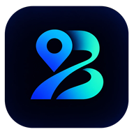
</p>

<h1 align="center">BlindRoute</h1>

<p align="center">
  <strong>Navegación guiada por voz en interiores para personas con discapacidad visual.</strong><br>
  <sub>Indica el camino paso a paso dentro de edificios, donde el GPS no llega.</sub>
</p>

<p align="center">
  
  
  
  
</p>

<table align="center">
  <tr>
    <td align="center" width="33%">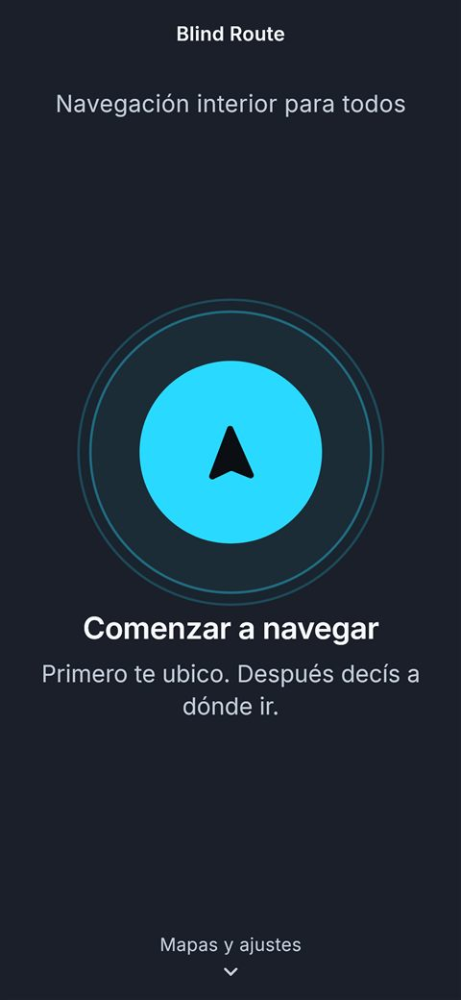</td>
    <td align="center" width="33%">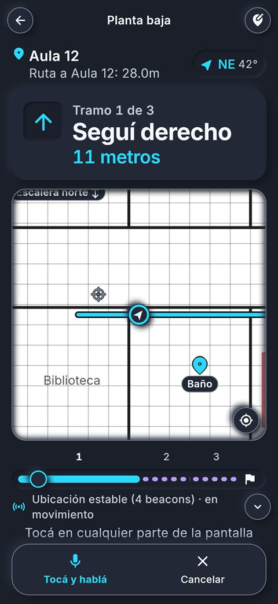</td>
    <td align="center" width="33%">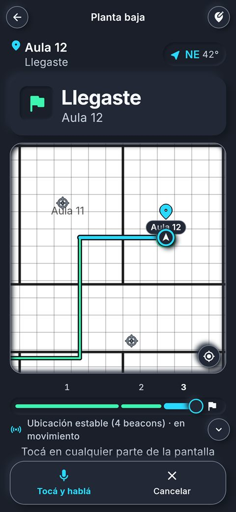</td>
  </tr>
  <tr>
    <td align="center"><sub><b>1.</b> Comenzar</sub></td>
    <td align="center"><sub><b>2.</b> Seguir las indicaciones</sub></td>
    <td align="center"><sub><b>3.</b> Llegar al destino</sub></td>
  </tr>
</table>

---

## Contenido

1. [Descripción](#descripción)
2. [Funcionamiento](#funcionamiento)
3. [Aplicaciones](#aplicaciones)
4. [Funciones principales](#funciones-principales)
5. [Accesibilidad](#accesibilidad)
6. [Capturas de pantalla](#capturas-de-pantalla)
7. [Requisitos y compatibilidad](#requisitos-y-compatibilidad)
8. [Estado del proyecto](#estado-del-proyecto)
9. [Compilación e instalación](#compilación-e-instalación)
10. [Estructura del código](#estructura-del-código)
11. [Tecnologías](#tecnologías)
12. [Datos y privacidad](#datos-y-privacidad)
13. [Documentación adicional](#documentación-adicional)

## Descripción

Desplazarse sin ayuda por un edificio desconocido, como una universidad, un hospital o un centro comercial, representa una dificultad importante para las personas ciegas o con baja visión. Además, el GPS de los teléfonos no funciona en interiores.

**BlindRoute** ofrece una solución a este problema. La persona indica en voz alta a qué lugar desea ir y la aplicación la guía **mediante instrucciones habladas** (seguir derecho, girar a la izquierda, tomar la escalera) hasta dejarla frente al destino.

La aplicación está diseñada para utilizarse **sin necesidad de mirar la pantalla**: basta con tocarla en cualquier punto para hablar, toda la información importante se comunica por voz y es compatible con TalkBack, el lector de pantalla de Android.

## Funcionamiento

El edificio se prepara una única vez. Se instalan **balizas Bluetooth** (*beacons*), pequeños dispositivos que emiten una señal de forma continua, y se carga el plano de cada piso en la aplicación de administración. A partir de ese momento, cada recorrido sigue estos pasos:

| Paso | Descripción | Recurso utilizado |
|:---:|---|---|
| **1** | El teléfono detecta las balizas cercanas y estima **la posición** de la persona sobre el plano. | Bluetooth |
| **2** | La persona indica **el destino**, por nombre o por tipo de lugar (por ejemplo, «baño» o «comer»). | Micrófono |
| **3** | La aplicación calcula **el camino**, evitando paredes y zonas no transitables. | Plano del edificio |
| **4** | La aplicación **guía por voz** según la dirección hacia la que mira la persona y recalcula la ruta si se desvía. | Voz y brújula |
| **5** | Al llegar, indica hacia dónde girar hasta **quedar de frente** al lugar y anuncia la llegada. | Brújula |

## Aplicaciones

El proyecto genera dos aplicaciones a partir del mismo código, que se instalan por separado:

| Aplicación | Destinada a | Función |
|---|---|---|
| **BlindRoute** | Personas que necesitan orientarse | Descargar los mapas publicados y recorrer el edificio |
| **BlindRoute Admin** | Responsables de preparar el edificio | Cargar edificios, pisos, balizas, zonas y lugares, calibrar la señal y publicar los mapas |

## Funciones principales

<table>
  <tr>
    <th width="50%">Aplicación para la persona usuaria</th>
    <th width="50%">Aplicación de administración</th>
  </tr>
  <tr valign="top">
    <td>
      <ul>
        <li><b>Detección automática</b> del edificio y del piso a partir de las balizas.</li>
        <li><b>Destino por voz</b>, por nombre o por categoría, o bien desde una lista.</li>
        <li><b>Voz sin conexión</b>: la aplicación descarga el español para entender la voz sin internet (Android 13 o superior).</li>
        <li><b>Indicaciones anticipadas</b> antes de cada giro y recálculo de la ruta ante un desvío.</li>
        <li><b>Recorridos entre pisos</b> por escalera o ascensor.</li>
        <li><b>Orientación al llegar</b>, hasta quedar de frente al lugar.</li>
        <li><b>Catálogo de mapas</b> para descargar, actualizar o eliminar.</li>
        <li><b>Preferencias</b> de velocidad, volumen y tono de la voz, vibración y reducción de movimiento.</li>
      </ul>
    </td>
    <td>
      <ul>
        <li>Edificios y pisos con la imagen del plano y su <b>escala en metros</b>.</li>
        <li>Ubicación de <b>balizas</b>, <b>zonas no transitables</b> y <b>lugares de interés</b> (aulas, baños, escaleras, ascensores).</li>
        <li><b>Calibración</b> de la señal y <b>puntos de referencia</b> para mejorar la precisión.</li>
        <li><b>Publicación en la nube</b> de los mapas para la aplicación de la persona usuaria.</li>
        <li><b>Panel de ajustes</b> de la navegación, por edificio o generales.</li>
      </ul>
    </td>
  </tr>
</table>

## Accesibilidad

La accesibilidad es el criterio principal del diseño:

- **Lector de pantalla:** todos los controles tienen etiquetas en español para TalkBack.
- **Texto ampliado:** las pantallas admiten el tamaño de letra al 200 % sin que se corte la información importante.
- **Contraste:** cada color se verificó según las pautas WCAG (texto de al menos 4,5:1 y controles de al menos 3:1).
- **Áreas táctiles** de 48 dp como mínimo.
- **Movimiento reducido:** se respeta la opción «Quitar animaciones» del sistema y existe un ajuste propio en la aplicación.

## Capturas de pantalla

Las capturas se generaron en la computadora con datos y planos de ejemplo.

<details open>
<summary><b>Aplicación para la persona usuaria</b></summary>
<br>
<table>
  <tr>
    <td align="center">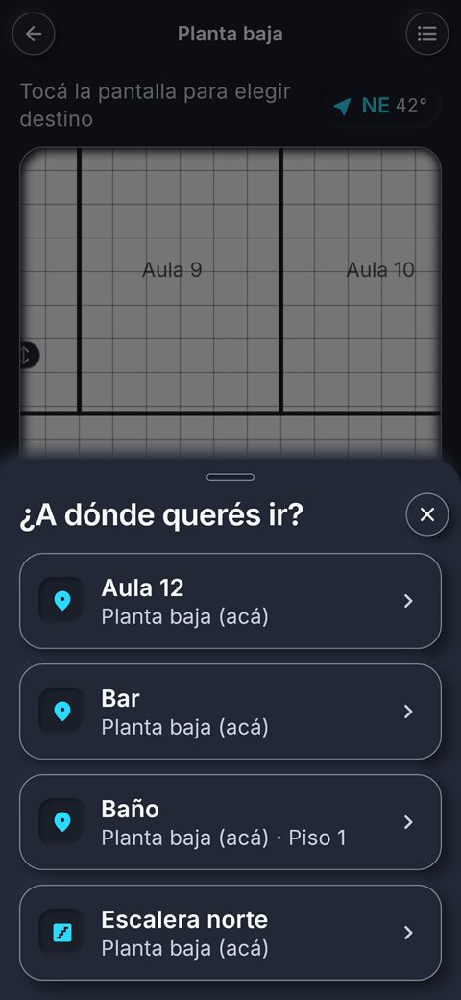<br><sub>Elección del destino</sub></td>
    <td align="center">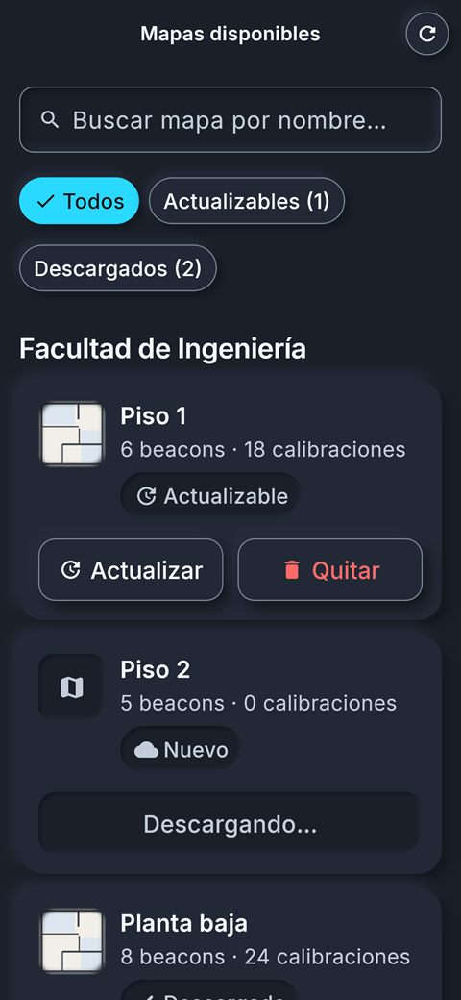<br><sub>Mapas disponibles</sub></td>
    <td align="center">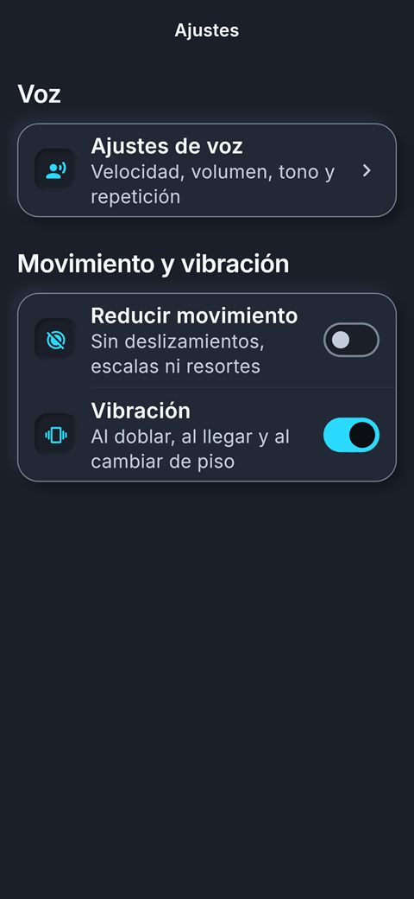<br><sub>Ajustes</sub></td>
  </tr>
</table>
</details>

<details open>
<summary><b>Aplicación de administración</b></summary>
<br>
<table>
  <tr>
    <td align="center">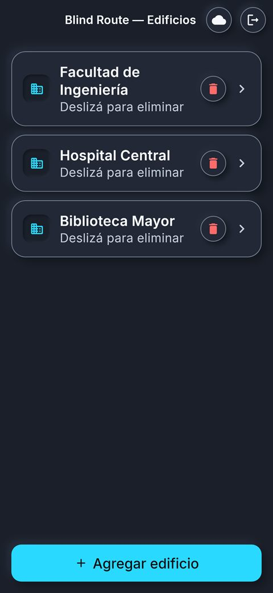<br><sub>Edificios</sub></td>
    <td align="center">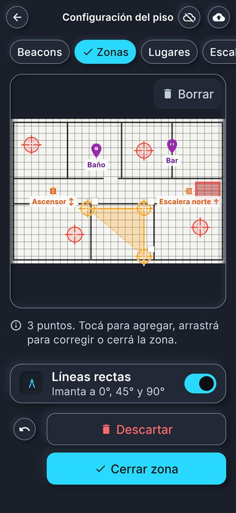<br><sub>Configuración del piso</sub></td>
    <td align="center">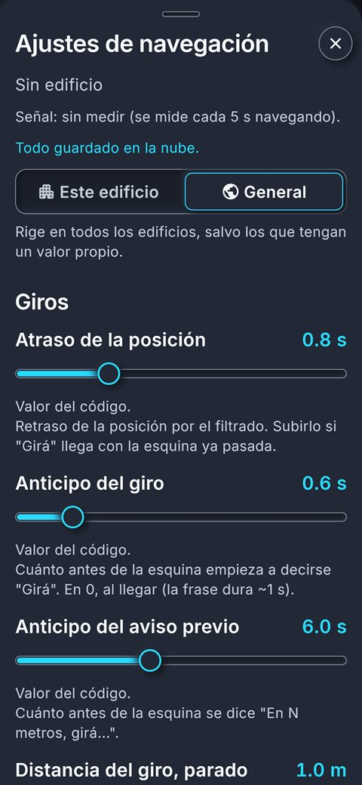<br><sub>Ajustes de navegación</sub></td>
  </tr>
</table>
</details>

<details>
<summary><b>Con la letra al 200 %</b></summary>
<br>
<table>
  <tr>
    <td align="center">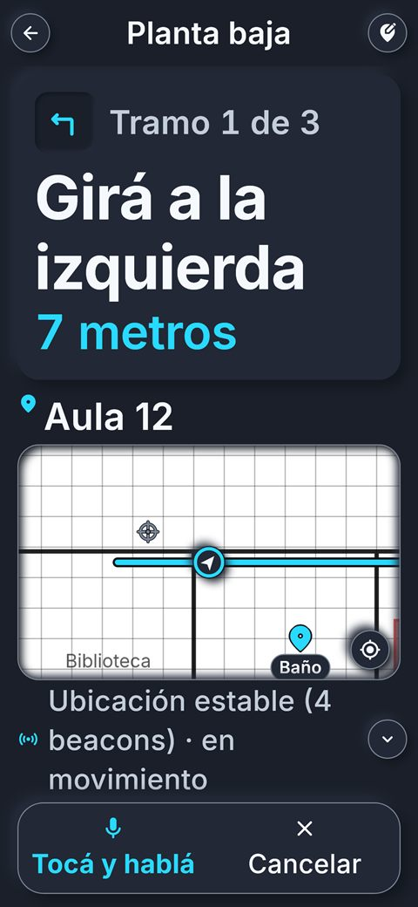<br><sub>Navegación</sub></td>
    <td align="center">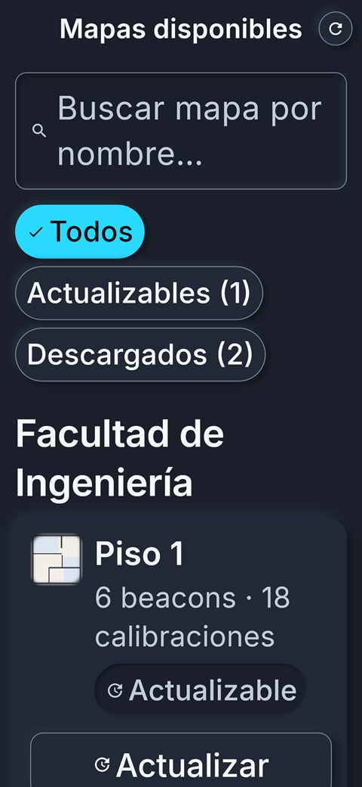<br><sub>Mapas disponibles</sub></td>
  </tr>
</table>
</details>

## Requisitos y compatibilidad

| Requisito | Detalle |
|---|---|
| **Sistema operativo** | Android 7.0 (API 24) o superior. Compilada para Android 16 (API 36). |
| **Dispositivo de prueba** | Samsung Galaxy S24 Ultra |
| **Sensores** | Bluetooth y brújula |
| **Entorno** | Un edificio con balizas instaladas y su mapa publicado |
| **Voz sin conexión** | Android 13 o superior. La primera vez, con conexión, la aplicación descarga el español para el reconocimiento de voz. Con versiones anteriores, entender la voz requiere internet. |

**Permisos que solicita la aplicación:**

| Permiso | Uso |
|---|---|
| Bluetooth | Detectar las balizas |
| Ubicación | Requerido por Android para buscar dispositivos Bluetooth |
| Micrófono | Indicar el destino por voz |
| Fotos | Seleccionar la imagen del plano (solo administración) |
| Internet | Descargar y publicar mapas, descargar el idioma de la voz y entender la voz mientras el idioma no esté descargado |
| Estado de la red | Avisar cuando no hay conexión para entender la voz |
| Vibración | Avisos al girar y al llegar |

## Estado del proyecto

El proyecto se encuentra en desarrollo y en etapa de calibración en dispositivos reales.

El proceso del rediseño visual se documenta en [`docs/ESTETICA.md`](docs/ESTETICA.md).

## Compilación e instalación

**Requisitos:** Flutter 3.41 (Dart 3.11), el SDK de Android y un teléfono con la depuración USB activada.

**1. Instalar las dependencias**

```bash
flutter pub get
```

**2. Ejecutar la aplicación para la persona usuaria**

```bash
flutter run --flavor user -t lib/main_user.dart
```

**3. Ejecutar la aplicación de administración**

```bash
flutter run --flavor admin -t lib/main_admin.dart
```

<details>
<summary><b>Generar e instalar un APK</b></summary>

```bash
flutter build apk --debug --flavor user -t lib/main_user.dart
```

```bash
adb install -r build/app/outputs/flutter-apk/app-user-debug.apk
```

Se recomienda instalar con `adb install -r` en lugar de `flutter install`, ya que este último puede desinstalar la aplicación y borrar sus datos. Para la aplicación de administración, se reemplaza `user` por `admin`.
</details>

<details>
<summary><b>Pruebas automáticas y galería de componentes</b></summary>

```bash
flutter test
```

```bash
flutter run --flavor user -t lib/main_galeria.dart
```

La galería muestra todos los componentes visuales. Se instala en lugar de la aplicación para la persona usuaria; para volver, se ejecuta nuevamente el paso 2.
</details>

## Estructura del código

El código se encuentra en `lib/` y es compartido por ambas aplicaciones:

| Ubicación | Contenido |
|---|---|
| `main_user.dart`, `main_admin.dart` | Punto de entrada de cada aplicación |
| `pantalla_*.dart`, `vista_navegacion.dart`, `mapa_widget.dart` | Pantallas y dibujo del plano |
| `design/` | Sistema de diseño: colores, tipografía, formas, movimiento y componentes |
| `bluetooth_helper.dart`, `procesador_senal.dart`, `posicionador.dart`, `filtro_un_euro.dart` | Procesamiento de la señal Bluetooth y cálculo de la posición |
| `pathfinder.dart`, `grilla_nav.dart`, `seguidor_ruta.dart`, `orientador_llegada.dart` | Cálculo y seguimiento de la ruta |
| `voz_service.dart`, `reconocimiento_telefono.dart`, `buscador_lugares.dart` | Síntesis y reconocimiento de voz, reconocimiento sin conexión, búsqueda de lugares |
| `database.dart` | Base de datos local |
| `supabase_service.dart`, `supabase_config.dart` | Conexión con la nube |

Las pruebas automáticas se encuentran en `test/` y los scripts SQL de la nube, en `supabase/`. El código nativo de Android que consulta y descarga el idioma para el reconocimiento de voz sin conexión se encuentra en `android/app/src/main/kotlin/com/example/blindroute/MainActivity.kt`.

## Tecnologías

| Área | Bibliotecas |
|---|---|
| Interfaz | Flutter, Material 3, tipografía Inter |
| Bluetooth | `flutter_blue_plus` |
| Sensores | `flutter_compass`, `sensors_plus` |
| Voz | `flutter_tts`, `speech_to_text` y el reconocimiento de voz en el teléfono de Android |
| Almacenamiento local | `sqflite`, `shared_preferences`, `path_provider` |
| Nube | `supabase_flutter` |
| Otras | `permission_handler`, `image_picker`, `wakelock_plus` |

## Datos y privacidad

- La **posición se calcula en el propio teléfono** y no se envía a la nube.
- La aplicación para la persona usuaria **no requiere una cuenta**. Solo la administración inicia sesión, con correo electrónico y contraseña.
- La nube almacena únicamente los **mapas publicados**, sus planos y los ajustes de navegación.
- El micrófono se activa **solo al solicitar un destino** o al responder una pregunta de la aplicación.
- Con el español descargado en el teléfono, la voz se reconoce **en el propio teléfono** y el audio no sale de él. Si no está descargado, se usa el reconocedor de Google por internet, que **envía el audio a los servidores de Google**.

## Documentación adicional

| Archivo | Contenido |
|---|---|
| [`docs/ESTETICA.md`](docs/ESTETICA.md) | Diseño visual actual, su evolución y tareas pendientes |
| [`supabase/ajustes_navegacion.sql`](supabase/ajustes_navegacion.sql) | Tabla y permisos de los ajustes de navegación en la nube |

---

<p align="center"><sub>Este repositorio no incluye una licencia de código abierto. La tipografía Inter se distribuye bajo la licencia SIL Open Font License.</sub></p>
