# Estética de BlindRoute

El rediseño hecho en la rama `estética` cambió los colores, la tipografía, las formas, los componentes, el movimiento y el ícono de las dos apps, sin modificar la navegación, el posicionamiento, el Bluetooth, la base de datos, Supabase ni los textos que se dicen por voz. En este documento se muestra cómo quedó, cómo se llegó a ese resultado y qué falta.

Las capturas se generaron en la computadora con tests de Flutter, usando la fuente y los íconos reales sobre un teléfono simulado de 384 × 832 dp con la letra al 115 %, salvo donde se indica el 200 %, y con datos y planos de ejemplo. Las de las fases 2 y 3 muestran la galería y Ajustes como están hoy, mientras que las demás muestran cada pantalla como quedó al terminar su fase.

Todos los componentes se pueden ver juntos en la galería, que no entra en las apps y se instala en lugar de la app del usuario:

```bash
flutter run --flavor user -t lib/main_galeria.dart
```

## 1. Cómo es hoy

La dirección visual se llamó "editor con relieve", porque toma los paneles oscuros de un editor de precisión y les suma controles que se ven levantados o hundidos. Las pantallas van en tema oscuro con Material 3, sin colores dinámicos, degradados, brillos, vidrio ni sombras de color, y el cian es el único acento, con un solo botón principal por pantalla.

En la Tabla 1 se resumen los colores principales. Los contrastes se calcularon con un script y se truncaron a dos decimales, para que un 4,499 no pase por 4,5, y los mínimos usados fueron 4,5:1 para texto, 7:1 para texto importante y 3:1 para íconos, bordes y gráficos. El verde y el violeta se reservan para los estados de la ruta, y la imagen del plano se trató aparte debido a que suele ser blanca y el cian da 1,68:1 contra ella, por lo que todo lo que se dibuja encima lleva un contorno o un fondo oscuro.

| Uso | Color | Contraste sobre el fondo |
|---|---|---|
| Fondo de las pantallas | `#1A1F29` | |
| Superficie levantada | `#222835` | 1,11 |
| Borde de lo que se toca | `#7A8594` | 4,41 |
| Texto principal | `#F5F8FC` | 15,50 |
| Texto secundario | `#C3CCD9` | 10,18 |
| Acento | `#29D9FF` | 9,79 |
| Tramo recorrido | `#3DF5B0` | 11,70 |
| Tramo siguiente | `#B79CFF` | 7,24 |
| Advertencia | `#FFC857` | 10,73 |
| Error | `#FF6B6B` | 5,94 |

*Tabla 1. Colores principales y su contraste contra el fondo de las pantallas.*

El relieve se arma con dos sombras, una oscura abajo a la derecha y otra clara arriba a la izquierda, que en lo levantado tienen 6 dp de desplazamiento y 12 dp de desenfoque, y en lo hundido van por dentro con 4 y 8 dp. Los botones y las tarjetas van levantados, mientras que el plano, los campos y las pistas van hundidos. Como la superficie da 1,11:1 contra el fondo, el relieve solo no alcanza para distinguir un control, por lo que todo lo que se toca lleva un borde de 1 px, salvo los rellenos de acento, que ya pasan el mínimo.

La tipografía es Inter 4.1, empaquetada en la app con pesos de 400 a 700 y con la escala de la Tabla 2, donde los números llevan cifras tabulares para que no se muevan al cambiar. Cuando la letra del teléfono llega a 1,2 veces la normal, los componentes se reacomodan, pasando la grilla de tarjetas a una columna o bajando los botones debajo del texto, para que ninguna palabra quede partida.

| Uso | Tamaño (sp) | Peso |
|---|---|---|
| Números grandes | 40 | 600 |
| Título grande | 34 | 700 |
| Indicación de la navegación | 28 | 700 |
| Números medianos | 28 | 600 |
| Título de tarjeta | 22 | 600 |
| Título de sección | 20 | 600 |
| Texto destacado | 17 | 600 |
| Botón | 17 | 500 |
| Texto común | 17 | 400 |
| Subtítulo | 15 | 400 |
| Título de la barra superior | 14 | 600 |
| Nota | 13 | 400 |
| Leyenda | 12 | 500 |

*Tabla 2. Escala de letra.*

Los íconos son los de Material en su variante redondeada, de 24 dp en filas, barras y botones, de 20 dp en chips y botones redondos y de 56 dp en los estados de pantalla, como una lista vacía o un error de conexión. No crecen con la letra, ya que lo que hay que leer es el texto y de esta manera los controles mantienen su forma. En las filas y las tarjetas el ícono va en cian dentro de un cuadro hundido de 40 dp, y la variante de contorno quedó para las pestañas inactivas, que hoy aparecen solamente en la galería. Las únicas flechas de otra variante son las de rumbo de `orientacion_service.dart`, que es parte de la lógica y no se tocó.

Las formas usan sólo cuatro radios, 12 dp en los campos, las pistas y el cuadro de los íconos, 14 en los botones, 20 en las tarjetas y 24 en las hojas y las barras flotantes, mientras que los chips y los botones de ícono son redondos del todo. Los botones y los campos miden 52 dp de alto y los botones redondos tienen 36 dp de dibujo adentro de un área de 48 dp. El espaciado es de 16 dp a los costados y dentro de las tarjetas, 12 dp entre tarjetas y 28 dp entre secciones.

El movimiento sigue la Tabla 3, con curvas que arrancan rápido y frenan suave, sin rebotes y sin animaciones que se repitan, por lo que mientras se espera algo se muestra un texto fijo en lugar de una ruedita. La única excepción son las ondas del botón del inicio, que son decorativas y se quedan quietas con movimiento reducido. Con "Quitar animaciones" del teléfono o con "Reducir movimiento" de Ajustes rige la última columna.

| Acción | Normal | Con movimiento reducido |
|---|---|---|
| Presionar | 120 ms, se hunde y se achica a 0,97 | 120 ms, cambia sólo la sombra |
| Soltar | 160 ms | Salta |
| Elegir una opción | 150 ms | Salta |
| Abrir y cerrar una pantalla | 260 y 200 ms, con 24 dp de recorrido | Fundido de 120 ms |
| Abrir y cerrar una hoja | 300 y 200 ms | Fundido de 120 ms |
| Cambio de tramo | Colores en 300 ms y cabezal por la ruta en 350 ms | El cabezal salta |
| Llegada | Fundido de 200 ms | Fundido de 120 ms |

*Tabla 3. Duración de las animaciones principales.*

Los componentes están en `lib/design/components/` y ninguna pantalla define colores sueltos, ya que todos salen de `lib/design/colores.dart` con su contraste anotado. Cada control tiene al menos 48 dp de área táctil, un nombre en español para TalkBack y el foco visible con un borde de acento de 2 px. La letra al 200 % se comprueba con tests que usan Inter de verdad y revisan que ningún texto se corte ni se parta, y en total quedaron 334 tests.

## 2. Cómo se llegó

### Fase 0, sistema de diseño

Se armó `lib/design/` con los colores, la tipografía, las formas, el movimiento y el tema, y se empaquetó Inter sin tocar ninguna pantalla, de manera que se pudo comprobar en el teléfono que las dos apps se seguían viendo igual que antes.

### Fase 1, ícono

El ícono de las dos apps, que se ve en la Figura 1, se armó a partir del logo, en versión adaptable, en versión común para Android 7 y anteriores y en versión monocromática para los íconos temáticos de Android 13. Se probó en el teléfono y anduvo.

<p align="center">
  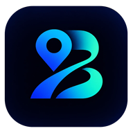
</p>
<p align="center"><em>Figura 1. Ícono de las dos apps.</em></p>

### Fase 2, paleta y componentes

Esta fase se hizo tres veces. La primera versión se descartó porque se veía plana, la segunda sumó más contraste y paneles de editor pero todavía usaba un degradado en el botón principal, y la tercera sacó los degradados y agregó el relieve, que es lo que quedó. Se hicieron los componentes, la línea de ruta sobre el plano, la línea de tiempo y la galería con dos pantallas de referencia, que se pueden ver en la Figura 2 junto con la pestaña de colores, donde cada color muestra su contraste. Se probó en el teléfono y anduvo.

<p align="center">
  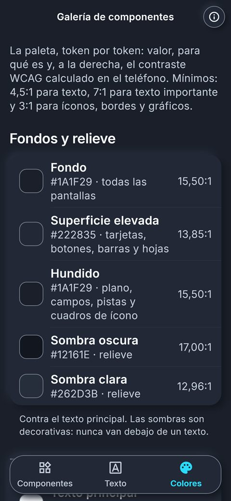
  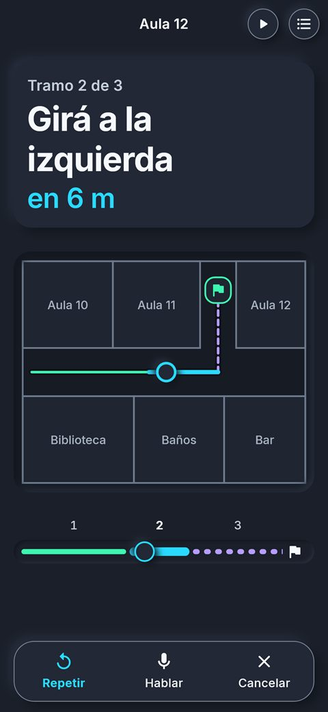
  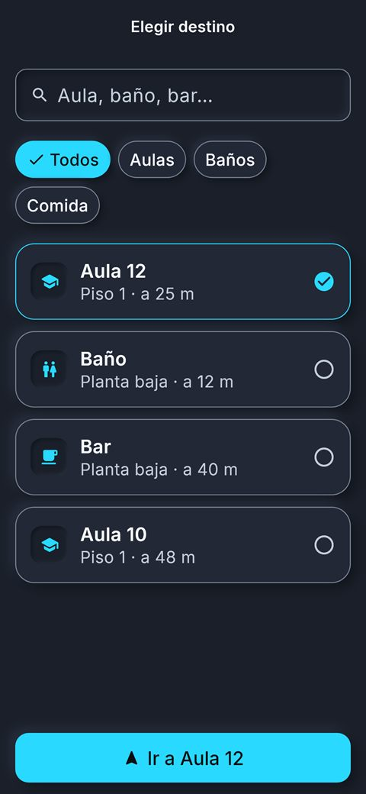
</p>
<p align="center"><em>Figura 2. Colores de la galería y las dos pantallas de referencia.</em></p>

### Fase 3, animaciones

Se implementó la Tabla 3 y se creó la pantalla Ajustes de la Figura 3, para poder reducir el movimiento desde la app sin depender del ajuste del teléfono y para poder apagar la vibración. Las hojas inferiores pasaron a tener una ruta propia, debido a que la de Material no dejaba cambiar la curva ni hacer el fundido y TalkBack la anunciaba como "Dialog". Se probó en el teléfono y anduvo. La fase 4, que iba a sumar texturas, se canceló.

<p align="center">
  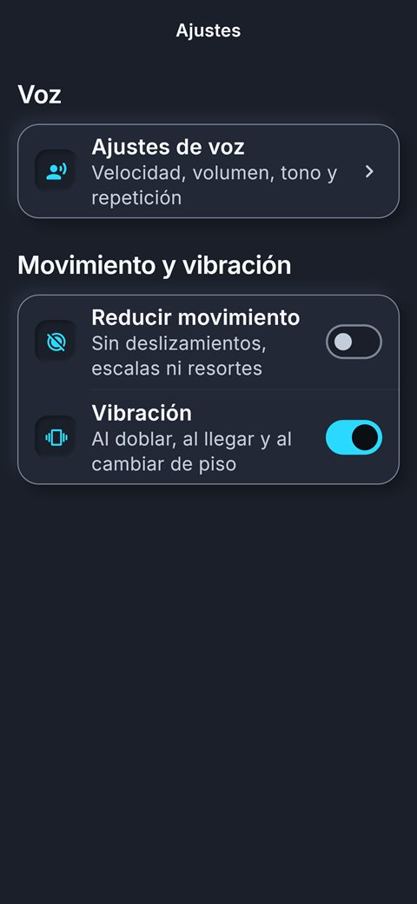
</p>
<p align="center"><em>Figura 3. Ajustes de la app del usuario.</em></p>

### Fase 5.1, inicio del usuario

El inicio pasó al sistema de diseño manteniendo "Comenzar a navegar" en todo el lugar libre, para que se pueda acertar sin mirar, con "Mapas disponibles" y "Ajustes" como filas. Como se ve en la Figura 4, con la letra al 200 % el botón mide lo que pide su contenido y la pantalla se desplaza. Se probó en parte en el teléfono, y el cian lleno se cambió después, en la fase 5.7, por la ficha de la Figura 10.

<p align="center">
  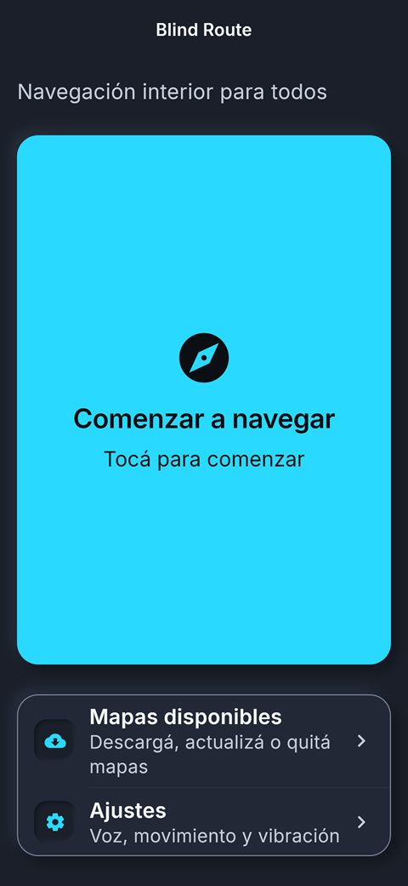
  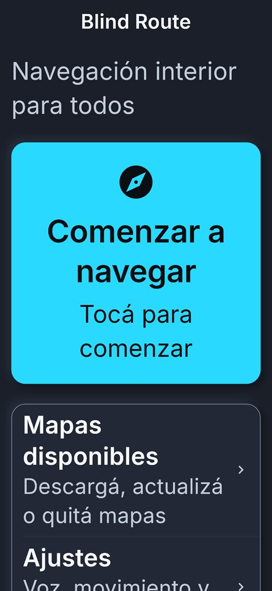
</p>
<p align="center"><em>Figura 4. Inicio al terminar la fase 5.1, con la letra al 115 % y al 200 %.</em></p>

### Fase 5.2, catálogo de mapas

En el catálogo, que se ve en la Figura 5, cada mapa pasó a una tarjeta con su miniatura y su estado, y mientras se espera se muestra un texto fijo. Se agregó un botón en la barra para volver a cargar la lista, porque la única forma era tirar hacia abajo y eso no se puede hacer con TalkBack. Las capturas mostraron que al 200 % la ayuda del buscador se cortaba, cosa que los tests no veían porque a esa escala armaban solamente las tarjetas, por lo que se corrigió y se sumó un test.

<p align="center">
  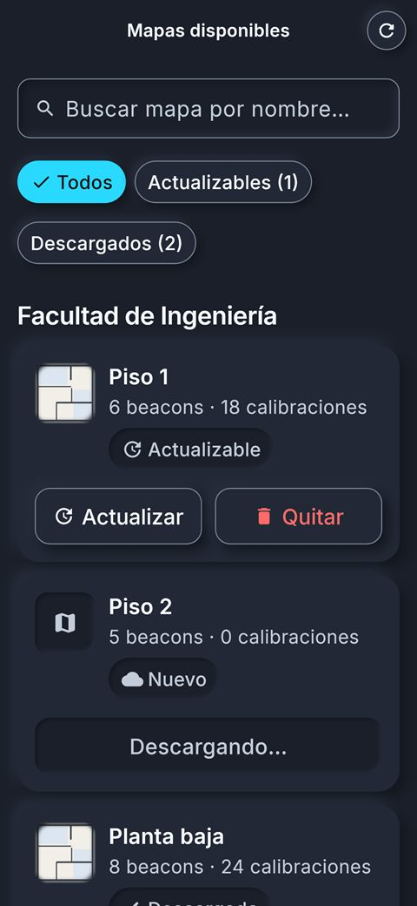
  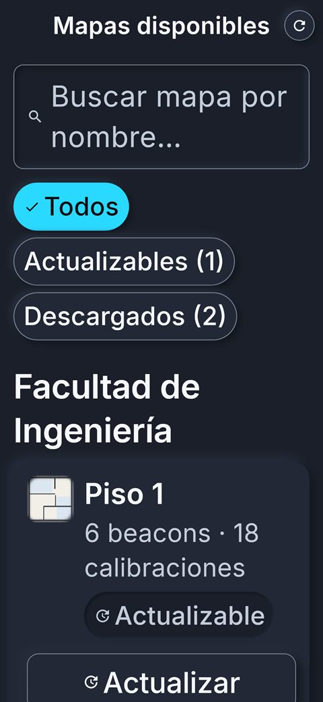
</p>
<p align="center"><em>Figura 5. Catálogo mientras se descarga un mapa y con la letra al 200 %.</em></p>

### Fase 5.3, login del admin

En el login de la Figura 6 los errores pasaron a ir debajo de cada campo, y mientras se ingresa el botón dice "Ingresando…" y TalkBack lo anuncia.

<p align="center">
  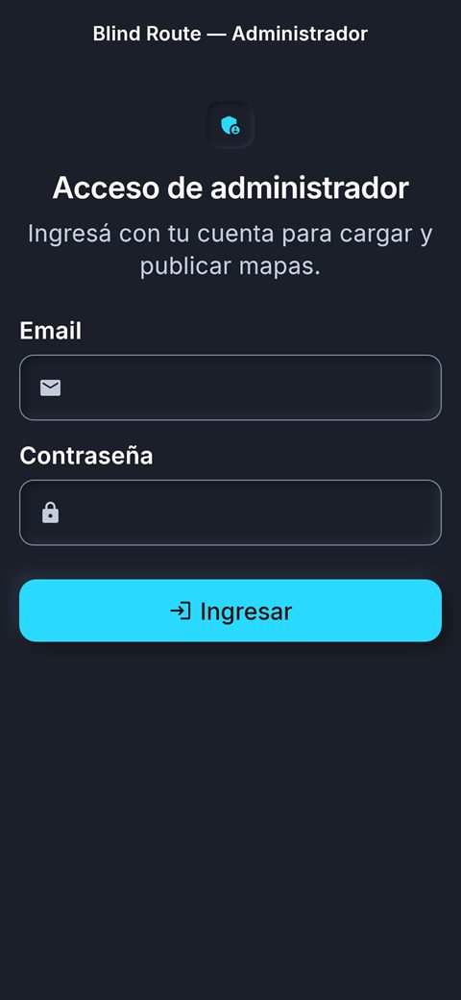
  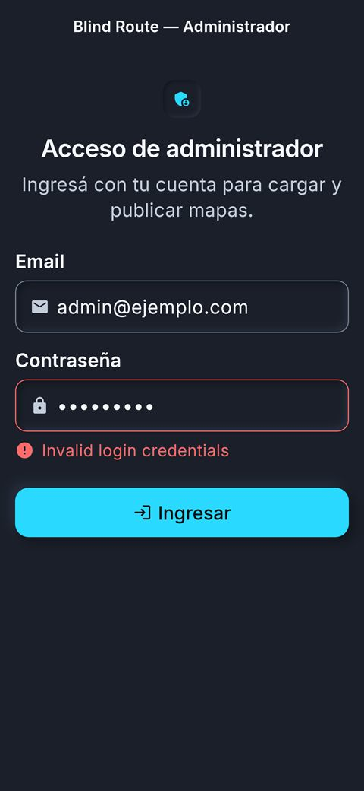
</p>
<p align="center"><em>Figura 6. Login vacío y con un error de Supabase.</em></p>

### Fase 5.4, edificios y pisos

En las listas de la Figura 7 cada elemento pasó a una tarjeta con sus botones aparte, y el número de piso se elige en una hoja con una grilla. Deslizar para eliminar se mantuvo, y como con TalkBack no se puede deslizar se agregó la acción "Eliminar" y después un tacho visible, los tres con la misma confirmación.

<p align="center">
  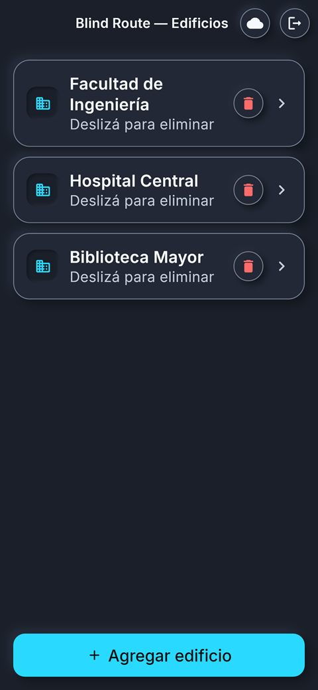
  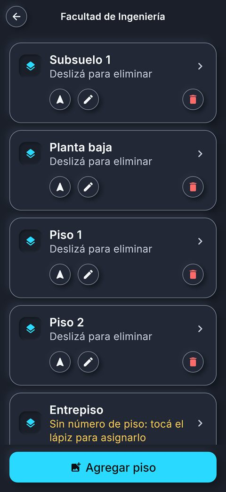
  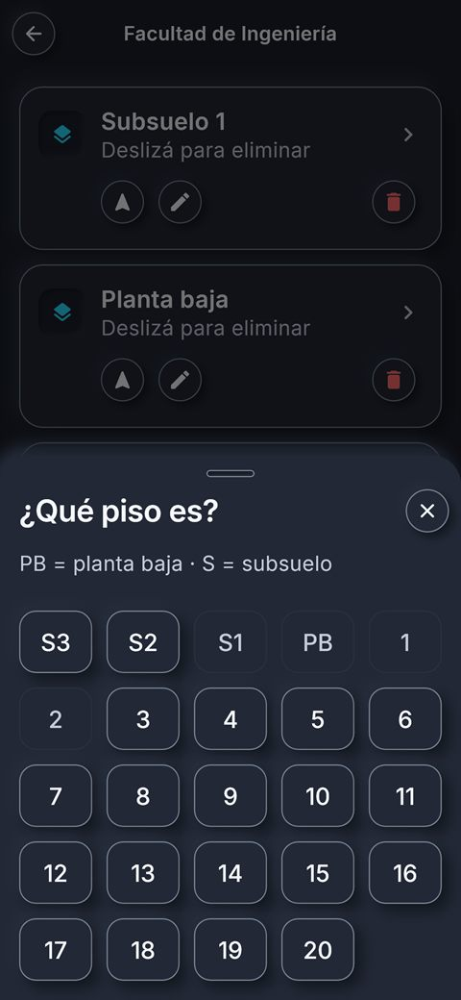
</p>
<p align="center"><em>Figura 7. Edificios, pisos y la hoja del número de piso.</em></p>

### Fase 5.5, mapas publicados

Los mapas publicados de la Figura 8 tomaron como modelo al catálogo del usuario, con "Tus mapas" primero y, en los mapas ajenos, la explicación de por qué no se pueden eliminar, que antes era solamente un candado que TalkBack no leía.

<p align="center">
  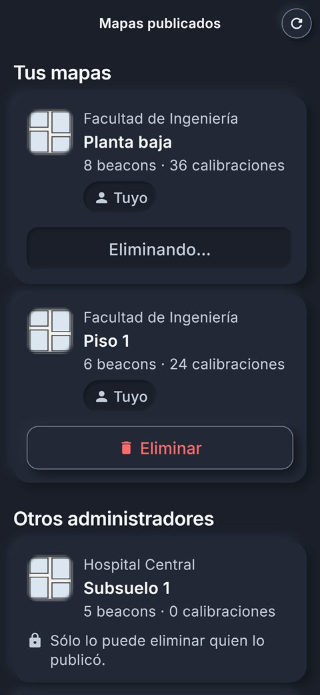
</p>
<p align="center"><em>Figura 8. Mapas publicados mientras se elimina uno.</em></p>

### Fase 5.6, configuración del piso y rubros

En la configuración de la Figura 9 los seis modos pasaron a una fila de chips que se desplaza, con el elegido en el medio porque las capturas mostraron que uno tocado contra el borde quedaba cortado, el plano a un panel hundido y los diálogos a hojas. Lo dibujado sobre el plano todavía es lo de antes, ya que ese dibujo se comparte con la navegación y se migró en la fase siguiente.

<p align="center">
  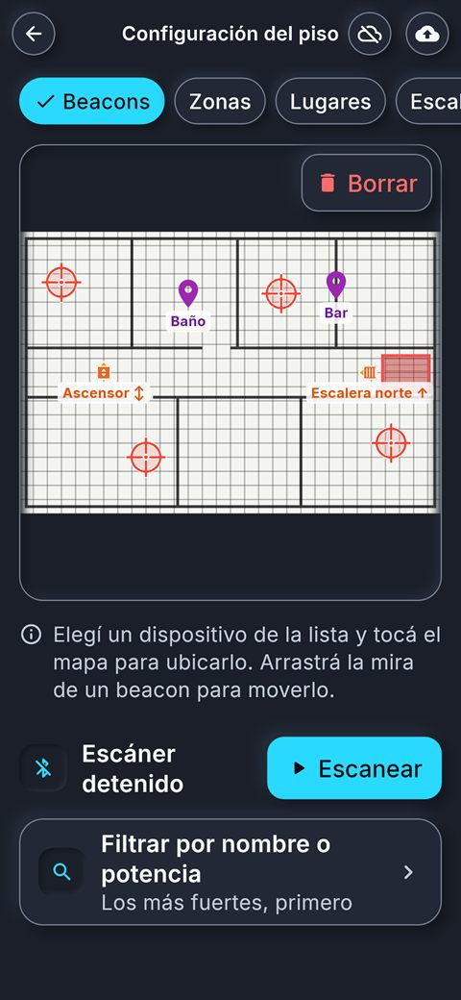
  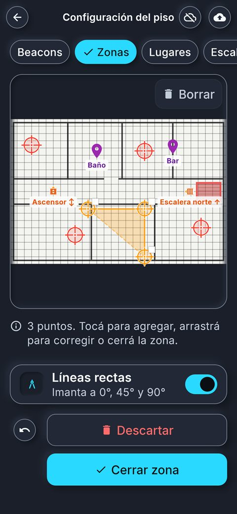
  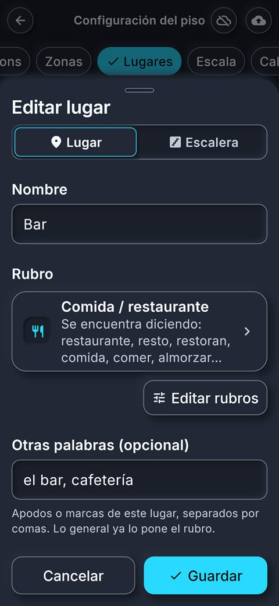
</p>
<p align="center"><em>Figura 9. Modos Beacons y Zonas y la hoja de un lugar.</em></p>

### Fase 5.7, navegación

La navegación, que se ve en la Figura 10, se separó en dos partes, pasando lo que se ve a `vista_navegacion.dart`, sin lógica, lo que permitió probarla sin Bluetooth y comparar `pantalla_naveg.dart` con la versión anterior para comprobar que la lógica no había cambiado. La navegación no cuenta tramos, por lo que "Tramo 1 de 3" y la línea de tiempo se calculan aparte, sólo para mostrar, mientras que la posición sigue siendo la real, con su flecha, ya que un cabezal pegado a la ruta quedaría mal cuando el usuario se sale de ella.

Con la letra al 200 % la indicación va primero y lo de arriba se desplaza, para que el plano siempre tenga lugar, aunque en la escalera, con el 200 % lineal de las capturas, la segunda línea de la aclaración queda a medio cortar. También se migraron Ajustes de voz, el panel del admin y el modo automático, y el botón del inicio pasó a la ficha, lo que permitió borrar el tema viejo. Para comprobar que los tests detectaban errores se rompió el código a propósito en 46 lugares, y como dos de esos cambios al principio no hicieron fallar ningún test, se agregó lo que faltaba.

<p align="center">
  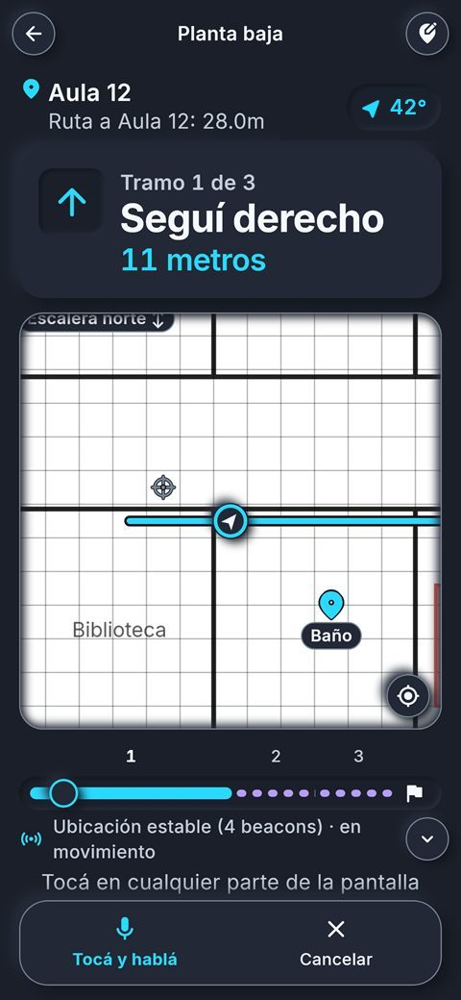
  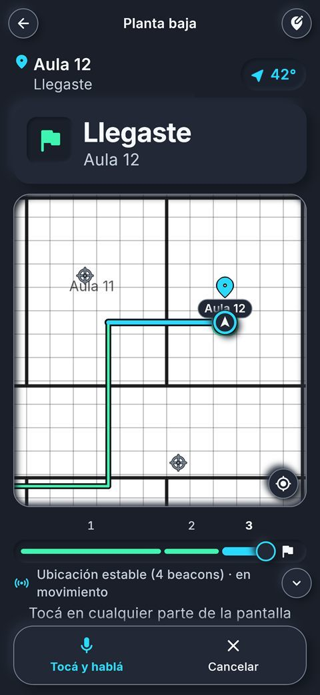
  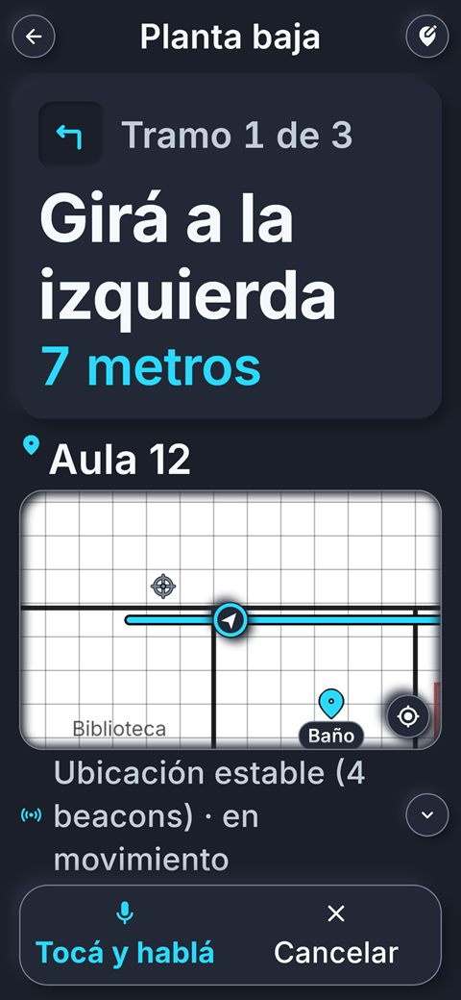
  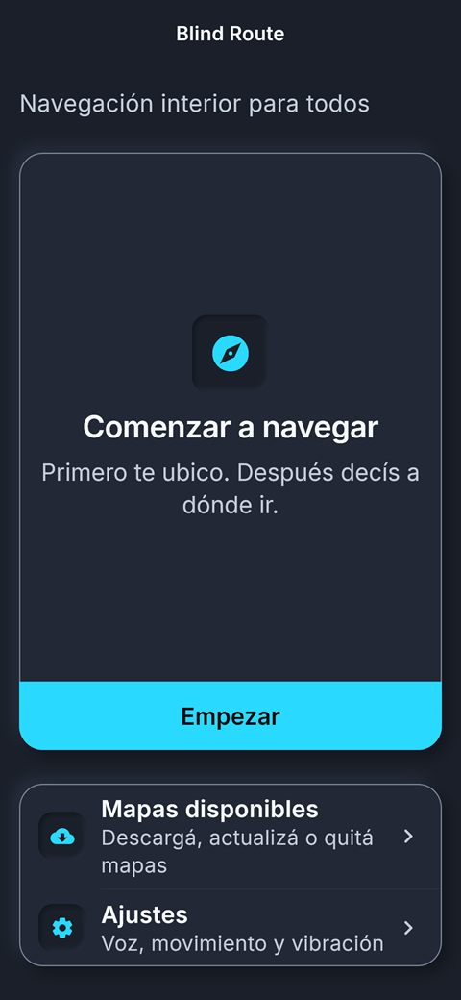
</p>
<p align="center"><em>Figura 10. Navegación guiando, al llegar y con la letra al 200 %, y la ficha del inicio.</em></p>

### Después de la 5.7, inicio con pulso y brújula

La ficha del inicio se reemplazó por un círculo de acento en el medio de la pantalla, sin tarjeta alrededor, que cada 2,6 s larga dos ondas que se abren y se apagan, como la señal de un GPS (`BotonPulso`). Con cada pulso la flecha del círculo va y viene a los costados, cada vez menos, como la aguja de una brújula que busca el norte. Como sin ver es difícil acertarle justo al círculo, toda la primera vista lleva a navegar, también la frase de arriba, la pista de abajo y los costados, y con "Reducir movimiento" las ondas y la flecha quedan quietas. "Mapas disponibles" y "Ajustes" pasaron debajo de la primera vista, de modo que se descubren desplazando, como se ve en la Figura 11, aunque TalkBack llega a ellos recorriendo la pantalla igual que antes.

La brújula de la navegación dejó de mostrar puntos cardinales, porque el norte de la app es el del plano, es decir lo que el administrador deja arriba en la pantalla, y no el geográfico. Ahora muestra solamente los grados respecto de ese norte, la pastilla se tiñe de acento de a poco a partir de los 45° y, a menos de 5°, lleva el borde de acento y vibra una vez, suave, con el interruptor de vibración de Ajustes. Para que vuelva a vibrar hay que alejarse más de 15°, así no vibra a cada lectura estando quieto en el límite.

<p align="center">
  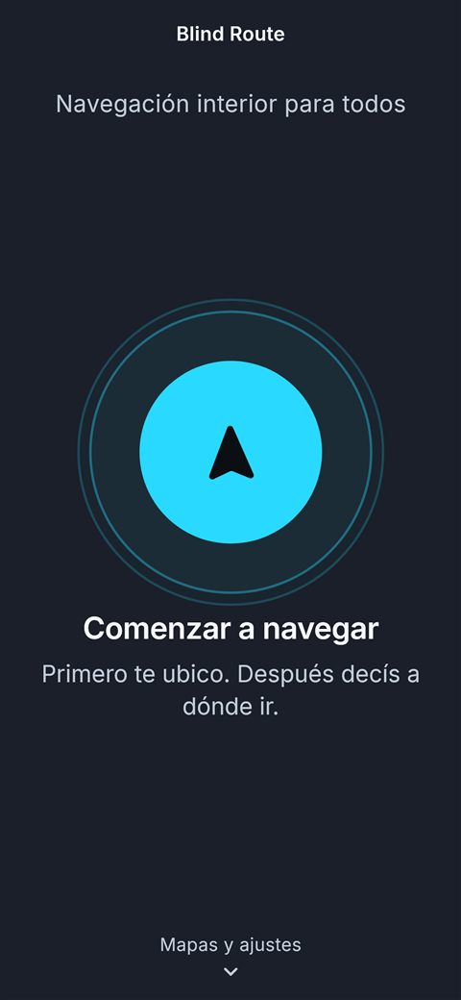
  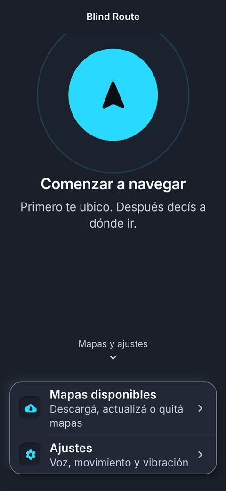
</p>
<p align="center"><em>Figura 11. El inicio con el botón con pulso y, desplazando, los mapas y los ajustes.</em></p>

## 3. Pendientes

Las fases 5.2 a 5.7 no se probaron en el teléfono ni con TalkBack y la 5.1 se probó en parte, por lo que falta sobre todo probar la navegación caminando, ya que el Bluetooth, la posición en vivo y la ruta real no se pueden simular en los tests. En esa prueba también hay que decidir la vibración, que quedó con las fuerzas de antes porque una vibración suave se puede perder caminando, mientras que la tabla de movimiento pide suave al doblar y media al llegar.

TalkBack todavía dice en inglés los textos que salen de Material, y los dos puntos de entrada siguen con el tema claro de antes, mientras que cada pantalla se pone el tema nuevo por su cuenta. Las dos cosas se resuelven tocando `main_user.dart` y `main_admin.dart`, que no se modificaron durante el rediseño.

Los errores de Supabase se muestran en inglés, como se ve en la Figura 6, porque traducirlos implica cambiar textos de la lógica, y el botón "Repetir" de la pantalla de referencia no se agregó a la navegación porque decir de nuevo la última indicación sería lógica nueva. Por otro lado, cuando una ruta se recalcula la cuenta de tramos puede cambiar, lo cual afecta solamente a lo que se ve. La fase 6, con tema claro y acentos alternativos, es opcional y no se hizo.
